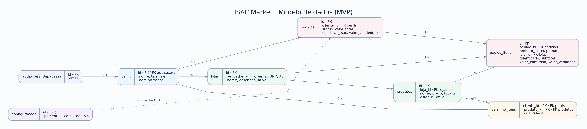

# ISAC Market

**Marketplace comunitário com geração de receita para o ISAC**

> **Status:** projeto acadêmico em desenvolvimento — primeira versão (MVP).  
> **Foco:** oferecer uma vitrine digital a pequenos vendedores da comunidade do Cabo e demonstrar um modelo de sustentabilidade financeira para o ISAC por meio de comissões sobre vendas confirmadas.

## Sumário

- [Sobre o projeto](#sobre-o-projeto)
- [Objetivos](#objetivos)
- [Como o ISAC Market funciona](#como-o-isac-market-funciona)
- [Funcionalidades previstas para o MVP](#funcionalidades-previstas-para-o-mvp)
- [Tecnologias](#tecnologias)
- [Como executar o projeto](#como-executar-o-projeto)
- [API do backend](#api-do-backend)
- [Banco de dados](#banco-de-dados)
- [Instalação do banco no Supabase](#instalação-do-banco-no-supabase)
- [Organização do repositório](#organização-do-repositório)
- [Escopo e próximas etapas](#escopo-e-próximas-etapas)
- [Segurança e colaboração](#segurança-e-colaboração)

## Sobre o projeto

O **ISAC Market** é uma proposta de plataforma web que reúne, em um único ambiente, produtos de pequenos vendedores e empreendedores da comunidade do Cabo.

A iniciativa busca responder a duas necessidades:

1. **Visibilidade para os vendedores locais:** facilitar a divulgação de produtos, preços e informações em uma vitrine digital acessível.
2. **Possibilidade de receita para o ISAC:** demonstrar um modelo de comissão sobre vendas confirmadas que poderá contribuir para as atividades da instituição.

O projeto está sendo desenvolvido como **protótipo acadêmico**. Suas regras e funcionalidades poderão ser ajustadas após a validação dos requisitos com o professor e o ISAC.

## Objetivos

- Disponibilizar um catálogo de produtos de diferentes vendedores.
- Permitir que vendedores cadastrem e gerenciem seus produtos.
- Oferecer carrinho de compras e registro de pedidos.
- Registrar pedidos e calcular a comissão correspondente ao ISAC.
- Disponibilizar informações de pedidos, produtos e comissões para acompanhamento administrativo.
- Construir uma base simples, organizada e preparada para futuras melhorias.

## Como o ISAC Market funciona

O funcionamento proposto envolve três participantes principais:

| Participante | O que faz na plataforma |
|---|---|
| **Vendedor** | Cadastra sua loja e publica produtos com nome, descrição, preço e foto. |
| **Cliente** | Consulta o catálogo, adiciona produtos ao carrinho e registra um pedido. |
| **Administrador (ISAC)** | Acompanha produtos, pedidos e comissões; no protótipo, confirma o pagamento de forma simulada. |

**Fluxo básico:**

1. O vendedor realiza o cadastro e publica seus produtos.
2. O cliente navega pelo catálogo e adiciona itens ao carrinho.
3. Ao finalizar a compra, o sistema cria um **pedido pendente**.
4. O valor dos itens e a comissão do ISAC ficam registrados no pedido.
5. Um administrador realiza a **confirmação simulada do pagamento**.
6. O pedido confirmado passa a compor os totais do painel de vendas e comissões.

### Exemplo de comissão

Na proposta, o percentual de **5% é apenas ilustrativo** e depende de validação com os participantes. O banco fornecido utiliza inicialmente essa taxa, que pode ser alterada por um administrador.

| Descrição | Valor |
|---|---:|
| Produto vendido | R$ 50,00 |
| Comissão do ISAC (5%) | R$ 2,50 |
| Valor correspondente ao vendedor | R$ 47,50 |

*Os valores não consideram eventuais custos operacionais, taxas ou despesas adicionais. Não há transferência financeira real nesta primeira versão.*

## Funcionalidades previstas para o MVP

A primeira versão foi delimitada para ser funcional sem depender de integrações externas de pagamento ou entrega.

| Área | Funcionalidades |
|---|---|
| **Acesso** | Cadastro e autenticação de usuários. |
| **Vendedores** | Cadastro de loja e gerenciamento de produtos. |
| **Catálogo** | Listagem de produtos com informações e imagens. |
| **Carrinho** | Inclusão e ajuste de quantidades de produtos. |
| **Pedidos** | Registro de pedidos e acompanhamento do status. |
| **Comissões** | Cálculo automático sobre os itens do pedido. |
| **Administração** | Consulta de pedidos, produtos e valores de comissão; confirmação simulada. |

> **Atenção ao andamento:** o projeto tem hoje um **backend próprio** (API em Node.js com PostgreSQL, coberta por testes automatizados) e um **frontend em React**. O frontend foi ligado ao backend recentemente; o fluxo completo (cadastro, carrinho, pedido, confirmação) ainda está em validação. O frontend também roda sozinho em **modo demonstração**, com dados de exemplo, o que permite apresentar as telas sem servidor.

## Tecnologias

| Tecnologia | Aplicação |
|---|---|
| **React + Vite** | Interface web e funcionalidades do site. |
| **Tailwind CSS** | Estilização responsiva para computadores e celulares. |
| **Node.js 24 + Express 5** | API do backend (`/api/v1`): autenticação por sessão, catálogo, carrinho, pedidos, comissões e administração. |
| **PostgreSQL 17** | Banco de dados do backend (migração em `backend/migrations`). |
| **Supabase** | Alternativa opcional ao backend próprio (SQL em `database/`), mantida como legado. |
| **Vercel** | Publicação do frontend na internet para apresentação e testes. |
| **Git + GitHub** | Versionamento do projeto e colaboração entre integrantes. |

## Como executar o projeto

Requisitos: **Node.js 24** (backend), **Node.js 20.19 ou mais recente** (frontend) e **Docker** para o PostgreSQL local.

### Backend (API)

```bash
cd backend
cp .env.example .env
docker compose up -d
npm install
npm run db:migrate
npm run db:seed -- --demo    # contas, lojas e produtos fictícios (senha isac1234)
npm run dev                  # API em http://localhost:3001
```

Contas de exemplo: `cliente@exemplo.com`, `lucia@exemplo.com` (vendedora) e `admin@isac.org` (administração).

Testes automatizados (precisam do PostgreSQL do `compose.yaml` no ar):

```bash
npm test
```

### Frontend

```bash
cd frontend
npm install
npm run dev                  # site em http://localhost:5173
```

O Vite encaminha `/api` para o backend. O backend só aceita ações de gravação (login, carrinho, pedidos) vindas do endereço exato configurado em `APP_ORIGIN` no `backend/.env` (por padrão `http://localhost:5173`); abra o site por esse mesmo endereço. Se aparecer *"Origem da requisição não permitida"*, o endereço da barra do navegador é diferente do `APP_ORIGIN`. Em ambientes remotos (como o GitHub Codespaces), use no `APP_ORIGIN` o endereço público da porta 5173; é possível listar vários endereços separados por vírgula, e o backend registra no terminal a linha `Origem recusada: ...` quando algo não bate.

> Para apresentar o projeto, veja o [roteiro de apresentação](docs/ROTEIRO_APRESENTACAO.md).

### Modo demonstração (sem backend)

Para apresentar as telas sem subir servidor, crie `frontend/.env.local` com `VITE_MODO=demo`. Os dados de exemplo ficam salvos só no navegador (contas e regras detalhadas em `frontend/README.md`).

## API do backend

Todas as rotas ficam em `/api/v1` e respondem JSON no formato `{ "data": ... }` (ou `{ "error": { "code", "message" } }`).

| Área | Rotas principais |
|---|---|
| **Acesso** | `POST /auth/cadastro`, `POST /auth/login`, `GET /auth/sessao`, `POST /auth/logout` |
| **Perfil** | `GET/PATCH /perfil` |
| **Catálogo (público)** | `GET /produtos`, `GET /produtos/:id`, `GET /lojas`, `GET /configuracoes/comissao` |
| **Carrinho** | `GET /carrinho`, `PUT/DELETE /carrinho/itens/:produtoId` |
| **Pedidos** | `POST /pedidos` (exige `Idempotency-Key`), `GET /pedidos`, `POST /pedidos/:id/cancelamento` |
| **Vendedor** | `GET/POST/PATCH /minha-loja`, `GET/POST/PATCH /minha-loja/produtos`, `POST /minha-loja/imagens`, `GET /minha-loja/vendas` |
| **Administração** | `GET /admin/pedidos`, `POST /admin/pedidos/:id/confirmacao`, `GET/PATCH /admin/lojas`, `GET/PATCH /admin/produtos`, `PATCH /admin/configuracoes/comissao` |

## Banco de dados

A modelagem inicial foi construída para **PostgreSQL/Supabase**, com **sete tabelas principais**. O backend próprio usa o mesmo modelo em `backend/migrations/001_modelo.sql` e acrescenta as tabelas `usuarios`, `sessoes` e `imagens`, porque a autenticação e o armazenamento de fotos deixam de depender do Supabase:

| Tabela | Finalidade |
|---|---|
| `perfis` | Dados dos usuários e indicação de administrador. |
| `lojas` | Informações das lojas associadas aos vendedores. |
| `produtos` | Catálogo, preço, descrição, foto, estoque e disponibilidade. |
| `carrinho_itens` | Produtos e quantidades selecionados pelos clientes. |
| `pedidos` | Identificação do cliente, situação e totais de cada compra. |
| `pedido_itens` | Itens de cada pedido, com preços e comissões registrados. |
| `configuracoes` | Percentual atual de comissão do ISAC. |

O sistema também utiliza os recursos nativos do Supabase: **Authentication** para contas de usuários e **Storage** para fotos dos produtos.

### Regras importantes da modelagem

- Cada vendedor possui **uma loja** no MVP.
- Um pedido pode conter produtos de **vendedores diferentes**.
- O valor e a comissão de cada item são preservados no momento da compra, mesmo se o preço do catálogo for alterado depois.
- Os pedidos possuem os estados `pendente`, `confirmado` e `cancelado`.
- O estoque é reservado na finalização e devolvido quando um pedido pendente é cancelado.
- As permissões de acesso usam **Row Level Security (RLS)**.
- A confirmação simulada de pagamento é restrita ao administrador.

### Diagrama de relacionamentos



> O arquivo de imagem deve estar na pasta `database/` para que o diagrama seja exibido corretamente no GitHub.

## Instalação do banco no Supabase (opcional)

Esta etapa só é necessária para usar o Supabase no lugar do backend próprio (`VITE_MODO=supabase` no frontend). Para o backend Node, siga [Como executar o projeto](#como-executar-o-projeto).

Para criar um banco de testes a partir do código disponibilizado:

1. Acesse [supabase.com](https://supabase.com/) e crie um projeto.
2. No painel do projeto, abra **SQL Editor → New query**.
3. Abra o arquivo [`database/ISAC_Market_banco_supabase.sql`](database/ISAC_Market_banco_supabase.sql) neste repositório.
4. Copie todo o conteúdo para o editor do Supabase e execute com **Run**.
5. Verifique a criação das **sete tabelas** em **Database → Tables**.
6. Confira no **Storage** o bucket de imagens `isac-produtos`.
7. Cadastre usuários de teste em **Authentication** e defina um administrador conforme as instruções do SQL/guia técnico.
8. Teste o fluxo de cadastro de loja, produtos, carrinho, pedido e confirmação simulada.

**Importante:** o script foi preparado para ser executado em **um projeto Supabase novo**. Não execute em um banco existente sem analisar previamente possíveis conflitos de tabelas, funções e políticas.

A descrição detalhada do processo e os exemplos de operações estão no arquivo `GUIA_ISAC_Market.md`, fornecido junto ao banco. Se for disponibilizado no repositório, mantenha-o em `database/`.

### Integração futura com React

Quando o frontend estiver criado, ele poderá utilizar a biblioteca `@supabase/supabase-js` para consultar dados e chamar as funções públicas definidas no SQL, como:

- `finalizar_pedido()` — gera o pedido a partir do carrinho do cliente autenticado.
- `cancelar_pedido()` — cancela um pedido pendente permitido e devolve seu estoque.
- `confirmar_pagamento_simulado(p_pedido_id)` — confirma um pedido, com permissão de administrador.
- `pedidos_do_vendedor()` — permite ao vendedor consultar itens vendidos pela própria loja.

As credenciais **públicas** de conexão serão configuradas no ambiente do frontend. Nunca inclua chaves secretas, senhas ou arquivos `.env` com credenciais privadas no GitHub.

## Organização do repositório

```text
Projeto-ISAC/
├── backend/                 # API Node.js + PostgreSQL
│   ├── migrations/          # modelo do banco (SQL)
│   ├── scripts/             # migrar, popular, promover admin, limpezas
│   ├── src/                 # módulos: auth, catálogo, carrinho, pedidos, lojas, admin...
│   ├── tests/               # testes unitários e de integração
│   └── compose.yaml         # PostgreSQL local (Docker)
├── frontend/                # site em React + Vite + Tailwind
│   └── src/services/        # backendApi, supabaseApi e demoApi
├── database/                # SQL e diagrama do modelo (versão Supabase)
├── .github/workflows/       # verificação automática (CI)
└── README.md
```

Cada módulo do backend separa **rotas, controlador, serviço e repositório**, e um teste de arquitetura garante que a camada HTTP não executa SQL.

## Escopo e próximas etapas

**Primeira versão (MVP):** apresentação da plataforma, catálogo, cadastro de produtos, carrinho, registro de pedidos, confirmação de pagamento **simulada** e painel de comissões.

**Possibilidades para versões futuras:**

- Integração com meios de pagamento reais.
- Repasses automáticos aos vendedores.
- Cálculo de frete e opções de entrega.
- Integrações com serviços externos.
- Melhorias de experiência de uso, relatórios e recursos do catálogo após testes.

Essas funcionalidades futuras **não fazem parte da entrega inicial definida na proposta**.

## Segurança e colaboração

Controles já implementados no backend:

- Senhas guardadas com **scrypt** e salt individual (nunca em texto puro).
- Sessão em cookie **HttpOnly** e **SameSite**, com marca **Secure** em produção; o servidor guarda apenas o *hash* do token.
- Proteção contra requisições de outros sites (verificação de origem e cabeçalho próprio).
- Limite de tentativas nas rotas de login e cadastro.
- Validação de todas as entradas e consultas SQL parametrizadas.
- Checkout **idempotente** e com bloqueio de estoque, para evitar pedidos duplicados e vendas acima do estoque.
- Upload de fotos limitado a JPG, PNG e WebP (até 5 MB), com conferência do conteúdo real do arquivo.


- O código SQL pode ser compartilhado pelo GitHub; ele **não contém, por si só, os dados reais de uma instância Supabase**.
- O banco efetivamente utilizado pela aplicação fica hospedado no Supabase.
- Para trabalhar com os **mesmos dados**, os integrantes devem utilizar o mesmo projeto Supabase, com acessos adequados.
- Alterações importantes no banco devem ser discutidas e versionadas no repositório.
- Não publique senhas, tokens privados ou chaves `service_role` no código-fonte.

---

**ISAC Market — tecnologia, empreendedorismo local e impacto social.**

*Projeto acadêmico baseado na proposta inicial “ISAC Market — Marketplace comunitário com geração de receita para o ISAC”, sujeito à validação e a ajustes de requisitos.*
